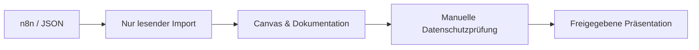

# SHOWCASE STUDIO

### Komplexe n8n-Workflows. Klar erzählt.

**Der lokale Workspace, um Automationen zu verstehen, zu erklären und ihre Darstellung kontrolliert zu teilen.**

  
  
  

[**Produkt verstehen**](#warum-showcase-studio) ·
[**Funktionen**](#produktbereiche) ·
[**Anleitungen**](#dokumentation) ·
[**Releases**](https://github.com/rootkid-code/showcase-studio-releases/releases) ·
[**Hilfe**](SUPPORT.md)

---

> [!IMPORTANT]
> **Noch kein öffentlicher Anwendungsdownload.** Zum Stand **23. November 2026** gibt es in diesem Repository keine veröffentlichten Release-Artefakte. Die abgebildeten Funktionen und Workflows stammen aus der privaten Entwicklung und sind **nicht als freigegebene Windows-Version** zu verstehen. Aktuelle Downloads erscheinen ausschließlich unter [GitHub Releases](https://github.com/rootkid-code/showcase-studio-releases/releases). **Code → Download ZIP** lädt nur dieses Informations-Repository.

## Warum Showcase Studio?

Ein n8n-Workflow kann technisch sauber sein und trotzdem schwer zu erklären: viele Knoten, Verbindungen, Notizen und Details. In einem Kundentermin interessiert aber nicht zuerst der JSON-Code – sondern **welcher Prozess abläuft, warum er sinnvoll ist und was dabei sicher geteilt werden darf**.

Showcase Studio ist als **read-only Präsentations- und Dokumentationsumgebung** für solche Workflows entwickelt. Es ersetzt **nicht** n8n, führt keine Workflows zur Demonstration aus und soll die Originalkonfiguration nicht verändern.

| 01 · Verstehen | 02 · Präsentieren | 03 · Freigeben |
|:--|:--|:--|
| Workflow-Übersicht, Node-Beziehungen und Notizen lesbar erschließen. | Komplexe Abläufe in verständliche Ansichten, Abschnitte und Erklärungen gliedern. | Darstellungen vor dem Teilen auf vertrauliche Informationen prüfen und bewusst freigeben. |

**Gedacht für:** Automationsagenturen, Berater, Entwickler, interne Prozessverantwortliche und Teams, die n8n-Logik vorführen, dokumentieren oder abnehmen lassen möchten.

## Produktbereiche

Die folgenden Bereiche sind im privaten Entwicklungsprojekt dokumentiert. Ihre Verfügbarkeit im späteren öffentlichen Paket richtet sich ausschließlich nach dessen Release Notes.

| Bereich | Nutzen |
|:--|:--|
| **n8n-Verbindung & JSON-Import** | Workflows aus einer passenden Instanz oder aus Dateien als Darstellung übernehmen. |
| **Workflow-Studio** | Canvas, Node-Fokus, Sticky Notes und Abschnitte zum verständlichen Durchgehen. |
| **Workflow-Landkarte** | Abhängigkeiten und Aufrufe zwischen Workflows veranschaulichen (fortgeschrittener Entwicklungszweig). |
| **Versionen & Vergleich** | Änderungen an Workflow-Strukturen im Entwicklungszweig nachvollziehen. |
| **Export & Review** | Geplante beziehungsweise im Entwicklungszweig implementierte Ausgaben wie HTML, SVG, PNG, Markdown, Mermaid und PDF – mit Freigabeprozess. |
| **Lokaler Betrieb** | Windows-zentrierter Einstieg ohne Pflicht zu einer von uns betriebenen Cloud. |

Die präzise Trennung von implementiertem Entwicklungsstand, noch ausstehender QA und geplantem Funktionsumfang findest du im [Feature-Status](docs/FEATURE_STATUS.md). Diese Tabelle ist keine Zertifizierung oder Zusage einer öffentlich installierbaren Version.

## So funktioniert der geplante Ablauf

**Deine eigentlichen Automationen bleiben in n8n.** Eine Präsentationskopie ist etwas anderes als das ausführbare Original. Für live verbundene Instanzen sind minimal berechtigte API-Zugänge erforderlich.

## Produktbilder & Markenidentität

  
   Aktuelle Markenidentität: Gold / Amber / Graphite. Die originalen SVG- und PNG-Dateien entsprechen dem neueren privaten Entwicklungszweig.

> [!NOTE]
> Die vorhandenen UI-Screenshots stammen noch aus einem **früheren Entwicklungsstand mit anderer Farb- und Logo-Identität**. Um keine veraltete Oberfläche als neu auszugeben, erscheinen sie nicht als aktuelle Produktgalerie. Sie sind transparent im [historischen Vorschauarchiv](docs/VISUAL_ARCHIVE.md) dokumentiert. Neue Screenshots folgen erst nach verifizierter Aufnahme mit bekannter Build-Version und Demo-Daten.

## Dokumentation

| Für Anwender | Inhalt |
|:--|:--|
| [**Erste Schritte**](docs/GETTING_STARTED.md) | Downloadstatus, Vorbereitung, Installation nach Freigabe, erster Workflow |
| [**Studio verwenden**](docs/USAGE_GUIDE.md) | Workflow lesen, strukturieren, präsentieren und exportieren |
| [**Datenschutz & Export**](docs/PRIVACY_AND_EXPORT.md) | Leserechte, sensible Inhalte, Freigabe und sichere Weitergabe |
| [**Fehler beheben**](docs/TROUBLESHOOTING.md) | Verbindung, Import, Installation, Logs und typische Stolpersteine |
| [**Feature-Status**](docs/FEATURE_STATUS.md) | Was auf welchem Entwicklungsniveau existiert und was noch fehlt |

| Projekt & Veröffentlichung | Inhalt |
|:--|:--|
| [Markenhandbuch](docs/BRANDING.md) | Original-Logo, Farben, Bildregeln und Quellen |
| [Release-Standard](docs/RELEASE_POLICY.md) | Tests, Sicherheitsabnahme und Veröffentlichungskriterien |
| [Release-Notes-Vorlage](docs/RELEASE_NOTES_TEMPLATE.md) | Version, Prüfsummen, Installation, bekannte Einschränkungen |
| [Support](SUPPORT.md) | Sichere Fehlerberichte und Kontaktwege |
| [Sicherheit](SECURITY.md) · [Rechte](NOTICE.md) | Responsible Disclosure und Nutzungs-/Markenhinweise |

## Installation & Downloads

**Erst nach einer tatsächlichen Freigabe** stehen eine ZIP beziehungsweise andere geprüfte Installationsdateien unter [Releases](https://github.com/rootkid-code/showcase-studio-releases/releases) bereit. Dann gilt:

1. Offizielle Release-Datei und zugehörige Release Notes prüfen.
2. Veröffentlichte SHA-256-Prüfsumme verifizieren, falls vorhanden.
3. Paket vollständig entpacken und die mitgelieferte Start-/Installationsanleitung lesen.
4. Das Studio öffnen und mit **synthetischen Testdaten** beginnen.
5. Erst anschließend eine n8n-Verbindung mit möglichst geringen Berechtigungen einrichten.

Die früher intern verwendeten Dateien `00-START-HIER.html` und `01-INSTALLIEREN.vbs` sind **keine** Dateien dieses öffentlichen Repositories. Verbindlich sind immer die Installationshinweise des tatsächlich veröffentlichten Pakets.

**Aktueller Veröffentlichungsstand:** Kein Release, kein garantierter Installer, keine bestätigte Plattformabnahme.

## Vertrauen statt falscher Versprechen

- **Keine stillschweigende Workflow-Ausführung:** Das Produkt ist als Anzeige- und Präsentationswerkzeug ausgelegt.
- **Explizite Inhaltsfreigabe:** Node-Namen, Sticky Notes, URLs, Notizen und exportierte Metadaten können sensibel sein.
- **Privater Quellcode bleibt privat:** Kein Signier-Publisher, keine privaten Schlüssel, keine echten Lizenzzertifikate oder Kundendaten in diesem Repo.
- **Ehrliche Nachweise:** Aussagen über Windows-Stabilität, Signaturen, Tests und unterstützte Features erst nach erfolgreichem Release-Gate.

Siehe [Sicherheit](SECURITY.md), [Datenschutz/Export](docs/PRIVACY_AND_EXPORT.md) und [Release-Freigabe](docs/RELEASE_POLICY.md).

## Kommerziell oder Open Source?

Dieses Repository ist **ein öffentlicher Produkt- und Distributionskanal, keine Veröffentlichung des privaten Softwarequellcodes**. Dass GitHub die README und später gegebenenfalls Free-Downloads zeigt, bedeutet **nicht**, dass Showcase Studio als Open Source oder zur kostenlosen gewerblichen Weiterverwertung lizenziert wurde.

Künftige Editionen und Nutzungsbedingungen werden gesondert dokumentiert. Eine spätere Pro-Edition beziehungsweise Dienstleistung ist möglich, aber **noch nicht als kaufbares Produkt veröffentlicht**.

---

  
   
  <strong>Showcase Studio</strong>
   
  Verstehen. Präsentieren. Bewusst freigeben.
   
  © 2026 Florian Windhager · Alle Rechte vorbehalten · Kein offizielles Produkt von n8n

