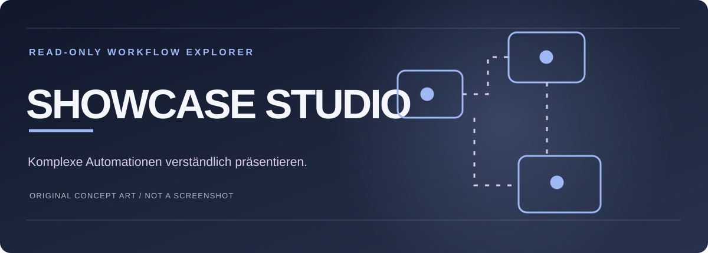
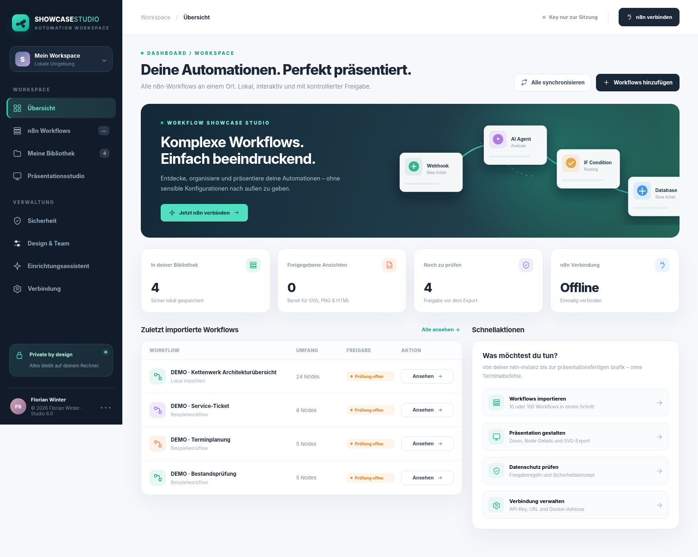
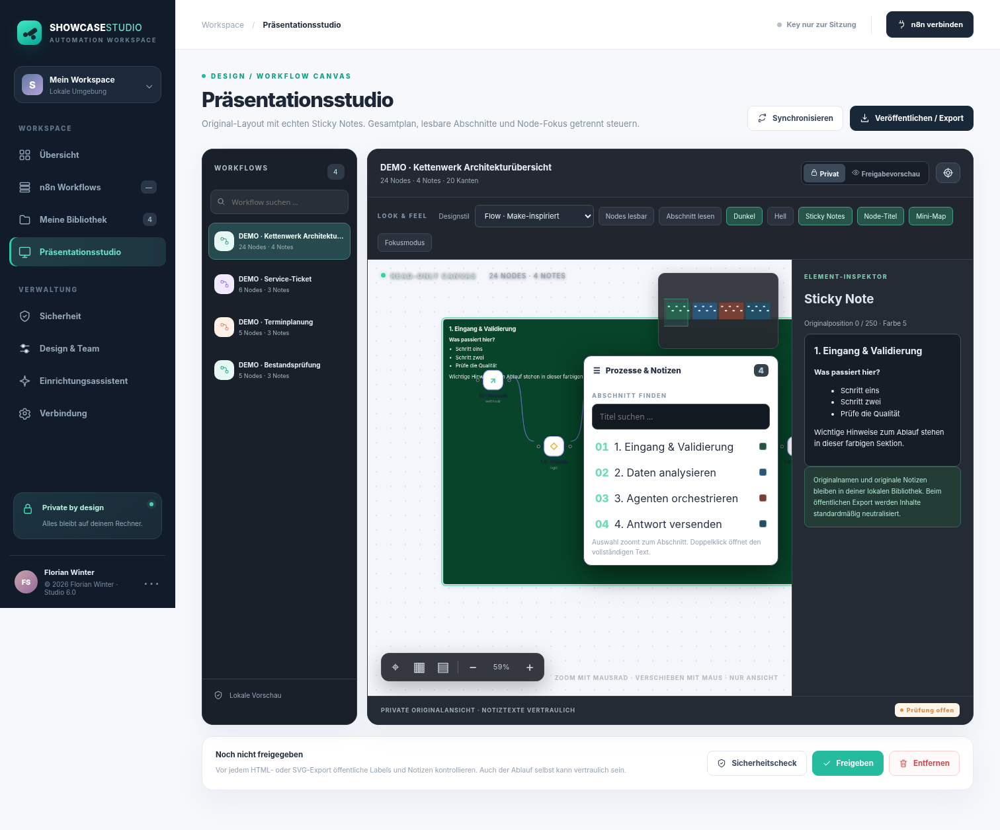
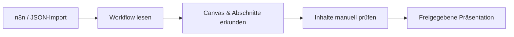

# SHOWCASE STUDIO

**Automationen verstehen. Workflows überzeugend präsentieren.**

Ein visueller, schreibgeschützter Workspace für n8n-Workflows – von der ersten Verbindung bis zur bewusst freigegebenen Präsentation.

  
  
  

[**Releases**](https://github.com/rootkid-code/showcase-studio-releases/releases) ·
[**Produktvorschau**](#produktvorschau) ·
[**Installation**](#installation-nach-releasefreigabe) ·
[**Hilfe**](SUPPORT.md) ·
[**Sicherheit**](SECURITY.md)

  

> [!IMPORTANT]
> **Aktuell noch kein öffentlicher Download.** Dieses Repository ist für die spätere Verteilung von Showcase Studio vorgesehen. Zum Stand **23. November 2026** gibt es hier **keine veröffentlichten GitHub Releases**. Ein privater Release Candidate wird entwickelt; die native Windows-Installer-End-to-End-Abnahme steht noch aus. Verbindlich sind immer die tatsächlich vorhandenen Einträge unter [Releases](https://github.com/rootkid-code/showcase-studio-releases/releases). Das GitHub-Menü **Code → Download ZIP** enthält **nicht** die Anwendung.

## Was ist Showcase Studio?

In n8n steckt die Logik eines Prozesses oft in komplexen Node-Netzwerken, technischen Verbindungen und langen Sticky Notes. **Showcase Studio macht daraus einen verständlichen Präsentations- und Review-Workspace**, ohne einen Workflow zum Vorführen ausführen zu müssen.

| Entdecken | Verstehen | Präsentieren |
| :--- | :--- | :--- |
| n8n-Workflows über einen geführten Verbindungsprozess oder JSON-Import betrachten. | Canvas, Node-Fokus, Abschnitte und Notizen helfen beim Lesen komplexer Abläufe. | Ansichten aufbereiten und Inhalte vor einem öffentlichen Export bewusst prüfen. |
| **Read-only als Produktprinzip** | **Vom Detail zur Gesamtansicht** | **Freigabe statt versehentlichem Teilen** |

### Für wen?

Für **KI- und Automationsberater, Agenturen, Entwickler und Projektteams**, die technische Workflows gegenüber Kunden oder Kollegen strukturiert erklären möchten – ohne dafür Zugang zu einem ausführbaren Workflow zu benötigen.

## Produktvorschau

  
   
  01 — Workspace & Dashboard · Entwicklungsansicht mit ausschließlich beispielhaften Workflow-Inhalten

<table>
<tr>
<td width="50%" valign="top">
  
   <strong>02 — Workflow-Canvas.</strong> Zusammenhänge und Notizen gezielt erklären.
</td>
<td width="50%" valign="top">
  
   <strong>03 — n8n verbinden.</strong> Geführter Einstieg und Hinweise zu minimalen Rechten.
</td>
</tr>
</table>

**Hinweis zu den Bildern:** Originale Showcase-Studio-UI-Vorschauen aus dem privaten Entwicklungsprojekt, mit Demo- beziehungsweise Beispielinhalten. Sie sind weder Nachweis einer öffentlichen Release-Freigabe noch Garantie für eine unveränderte finale Oberfläche.

## So ist der Workflow gedacht

- **Keine Workflow-Ausführung zum Präsentieren:** Showcase Studio ist auf lesende Erkundung ausgelegt und ersetzt nicht die n8n-Laufzeit.
- **Klare Trennung von privat und öffentlich:** Lokale Originalinhalte und bewusst freigegebene Ansichten sind unterschiedliche Bereiche.
- **Kontrolle vor dem Teilen:** Node-Texte, Sticky Notes und Geschäftslogik können vertraulich sein – vor einem Export müssen sie geprüft werden.
- **Lokaler Windows-Einstieg:** Die geplante Distribution setzt auf einen geführten Installer statt auf Terminalbefehle im Alltag.

> [!NOTE]
> Diese Punkte beschreiben das im privaten Entwicklungsstand dokumentierte Produktkonzept und seine vorhandenen UI-Bereiche. Sie stellen **keine unabhängige Sicherheitszertifizierung** und keinen vollständig abgenommenen Windows-Release dar.

## Installation nach Releasefreigabe

Sobald eine tatsächlich freigegebene Windows-Version vorhanden ist:

1. Die passende ZIP-Datei **ausschließlich aus** [GitHub Releases](https://github.com/rootkid-code/showcase-studio-releases/releases) herunterladen und die zugehörigen Release Notes lesen.
2. Falls veröffentlicht, den **SHA-256-Prüfwert** mit der Release-Angabe vergleichen; die ZIP anschließend vollständig entpacken.
3. Im entpackten Paket `00-START-HIER.html` öffnen und dem Installationsassistenten folgen. Der im Entwicklungsstand vorgesehene Einstieg heißt `01-INSTALLIEREN.vbs`.
4. Nach erfolgreicher Installation die Anwendung über den bereitgestellten Starter beziehungsweise die angelegte Verknüpfung öffnen.
5. Für eine n8n-Verbindung **nur erforderliche Leserechte** vergeben. API-Schlüssel niemals in Screenshots, Issues oder exportierten Beispielen veröffentlichen.

**Voraussetzungen / Umfang:** Zielplattform ist Windows 11; eine erreichbare n8n-Instanz oder ein geeigneter JSON-Workflow ist für die entsprechende Nutzung erforderlich. Verbindliche Systemvoraussetzungen, Paketnamen und gegebenenfalls geänderte Installationsschritte werden **erst in den jeweiligen Release Notes** festgelegt. Es ist derzeit **kein installierbares Paket** in diesem Repository veröffentlicht.

## Downloads & Versionsstand

| Bereich | Öffentlicher Stand |
| :--- | :--- |
| [Neueste Releases](https://github.com/rootkid-code/showcase-studio-releases/releases) | Noch keine Veröffentlichung (Stand 23.11.2026) |
| Windows-Installer | Native End-to-End-Abnahme vor Freigabe ausstehend |
| Release Notes / Prüfsummen | Werden je veröffentlichtem Artefakt bereitgestellt, sofern verfügbar |
| Quellcode | Nicht Bestandteil dieses öffentlichen Distributionsrepositories |
| Release-Prozess | [Freigabe- und Integritätskriterien](docs/RELEASE_POLICY.md) |

**Wichtig:** Der private Entwicklungsstand und interne Versionsbezeichnungen sind **keine** öffentlichen Downloadversionen.

## Sicherheit & Datenschutz

Showcase Studio behandelt die **Lesbarkeit technischer Automationen** als Produktfunktion – und die **Freigabe von Informationen** als eigenen Arbeitsschritt. Das ersetzt keine Prüfung der gewählten n8n-Berechtigungen, der Exportinhalte oder der tatsächlichen Windows-Paketierung.

- n8n-Zugriff auf das notwendige Minimum einschränken; keine Schreib-, Ausführungs- oder Credential-Rechte für reine Präsentationen erteilen.
- Vor einer Veröffentlichung alle personenbezogenen Informationen, URLs, interne Kommentare, Credentials und Geschäftsdetails prüfen.
- Keine echten API-Schlüssel, Workflow-Exporte oder vollständigen Diagnoseprotokolle in öffentliche Issues hochladen.
- Private Lizenz-Publisher, Signaturschlüssel und interne Werkzeuge dürfen **nicht** in Endnutzer-Releases gelangen.

Sicherheitsmeldungen: [SECURITY.md](SECURITY.md) · Hilfestellung und redigierte Fehlerberichte: [SUPPORT.md](SUPPORT.md)

## Häufige Fragen

<strong>Wo kann ich Showcase Studio herunterladen?</strong>

Aktuell noch nicht öffentlich. Sobald eine Version freigegeben ist, erscheint sie mit Dateien und Release Notes auf der <a href="https://github.com/rootkid-code/showcase-studio-releases/releases">GitHub-Releases-Seite</a>. Ein grüner `Code`-Button ist kein Anwendungsdownload.

<strong>Verändert Showcase Studio meine n8n-Workflows?</strong>

Die Anwendung ist als **Read-only-Explorer** konzipiert. Verwende trotzdem nur einen n8n-API-Key mit den minimal erforderlichen Leserechten. Die tatsächlichen Rechte werden auf Seite der n8n-Instanz durchgesetzt.

<strong>Ist dieses Repository Open Source?</strong>

Nein. Dieses öffentliche Repository dient zur Produktinformation und, nach Freigabe, zur Bereitstellung von Release-Artefakten. Eine Veröffentlichung ist **nicht automatisch eine Open-Source-Lizenz**. Siehe <a href="NOTICE.md">Rechte und Hinweise</a>; zukünftige Softwarepakete können gesonderten Nutzungsbedingungen unterliegen.

---

  © 2026 Florian Windhager · Showcase Studio · Alle Rechte vorbehalten
   
  Original-Logo und Produktgrafiken · Keine Herausgabe privater Entwicklungs- oder Lizenzierungswerkzeuge

