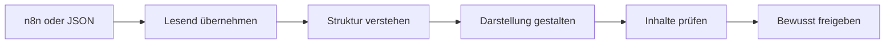

**Deutsch** · [English](docs/README.en.md)

<picture>
  <source media="(prefers-color-scheme: dark)" srcset="assets/brand/showcase-hero-dark.svg" />
  
</picture>

# Showcase Studio

**Workflow-Komplexität reduzieren. Prozesse überzeugend erklären.**

Ein lokaler Präsentations- und Dokumentations-Workspace für n8n-Automationen.

[**Produkt**](#was-ist-showcase-studio) · [**Funktionen**](#produktbereiche) · [**Erste Schritte**](docs/GETTING_STARTED.md) · [**Dokumentation**](docs/README.md) · [**Releases**](https://github.com/rootkid-code/showcase-studio-releases/releases)

> [!IMPORTANT]
> **Der öffentliche Download ist noch nicht freigegeben.** In diesem Repository gibt es zum Stand **23. November 2026** noch keine veröffentlichte Anwendung. Die hier beschriebenen Funktionen stammen aus der privaten Entwicklung; eine vollständig abgenommene Windows-Version liegt **nicht** als GitHub-Release vor. Das Menü **Code → Download ZIP** enthält lediglich die Dokumentation dieses Repositories.

## Was ist Showcase Studio?

Ein funktionierender n8n-Workflow ist nicht automatisch eine verständliche Präsentation. Knoten, Verzweigungen, technische Bezeichnungen und Sticky Notes verdecken häufig die eigentliche Prozessgeschichte.

**Showcase Studio** untersucht einen anderen Blickwinkel: Workflows lesend übernehmen, Zusammenhänge klar darstellen und eine Präsentationsfassung **erst nach bewusster Prüfung** weitergeben.

<table>
<tr>
<td width="33%" valign="top">
  <strong>01 / Verstehen</strong>  
  Die Struktur eines Workflows erkunden, Verbindungen nachvollziehen und wichtige Schritte herausarbeiten.
</td>
<td width="33%" valign="top">
  <strong>02 / Präsentieren</strong>  
  Aus technischen Abläufen eine lesbare Geschichte mit Canvas, Abschnitten und Node-Fokus machen.
</td>
<td width="34%" valign="top">
  <strong>03 / Freigeben</strong>  
  Texte, Notizen und Daten vor jeder Weitergabe kontrollieren – der Originalworkflow bleibt getrennt.
</td>
</tr>
</table>

**Für wen?** Für Menschen, die Automationen entwickeln, erklären oder gemeinsam mit Teams überprüfen: Freelancer, Agenturen, interne Prozessverantwortliche, Entwickler und Lernende.

## Ein klarer Ablauf

Der Workflow läuft weiterhin in **n8n**. Showcase Studio ist **kein n8n-Editor und kein Ersatz für die Ausführung**. Bei einer Live-Verbindung müssen Zugriffsrechte direkt in n8n auf das notwendige Minimum begrenzt werden.

## Produktbereiche

Die Module sind im privaten Entwicklungsprojekt vorhanden, werden dort weiterentwickelt oder sind als nächste Schritte dokumentiert. **Keine Zeile dieser Übersicht bedeutet, dass diese Funktion schon in einer öffentlich herunterladbaren Version getestet wurde.**

| Bereich | Was daraus entsteht | Entwicklungsstand |
|:--|:--|:--|
| n8n / JSON | Workflow-Import und geführte Verbindung | Privater Entwicklungsstand |
| Präsentationsstudio | Canvas, Abschnitte, Node-Fokus und Sticky Notes | Privater Entwicklungsstand |
| Workflow-Landkarte | Aufrufketten und Sub-Workflow-Beziehungen | Fortgeschrittener privater Zweig |
| Versionen & Vergleich | Strukturelle Unterschiede nachvollziehbar erklären | Fortgeschrittener privater Zweig |
| Exporte | HTML, SVG, PNG, Markdown, Mermaid und weitere Formate | Implementierungen im Entwicklungszweig; Release-QA ausstehend |
| Privacy Review | Bereinigen, prüfen und bewusst freigeben | Entwicklungsstand; nicht öffentlich zertifiziert |

Mehr Details: [Feature-Status und Prüfgrenzen](docs/FEATURE_STATUS.md).

## Visuelle Identität

**Gold · Graphite · ruhige, funktionale Oberflächen**

Die Marke verwendet die tatsächlich vorhandenen Original-Assets des Projekts. Die Titellayouts oben sind eigene Konzeptgrafiken – keine Screenshots eines ausführbaren Builds.

Die bisherigen Screenshots gehören zu einer älteren Oberfläche und sind deshalb aus dieser Präsentation entfernt. Du findest sie weiterhin im eindeutig beschrifteten [historischen Bildarchiv](docs/VISUAL_ARCHIVE.md). Neue Produktbilder werden erst mit tatsächlichem Build-Nachweis, Testdaten und visueller Freigabe gezeigt.

## Starten, sobald eine freigegebene Version existiert

1. Unter [**GitHub Releases**](https://github.com/rootkid-code/showcase-studio-releases/releases) eine tatsächliche Version mit **Dateianhang** öffnen.
2. Die Release Notes lesen: unterstützte Plattform, Voraussetzungen, bekannte Einschränkungen und gegebenenfalls SHA-256.
3. Das dafür vorgesehene Paket vollständig herunterladen und der **im Paket enthaltenen** Installationsanleitung folgen.
4. Zunächst mit einem synthetischen Demo-Workflow testen; erst danach gegebenenfalls eine eigene n8n-Instanz mit minimalen Leserechten verbinden.

**Aktuell ist dieser Vorgang noch nicht möglich:** Es wurde kein offizielles öffentliches Installationspaket hochgeladen.

## Dokumentation

<table>
<tr>
<td width="50%" valign="top">

**Für Anwender**

- [Erste Schritte](docs/GETTING_STARTED.md)
- [Studio & Workflow-Präsentation](docs/USAGE_GUIDE.md)
- [Datenschutz & Export](docs/PRIVACY_AND_EXPORT.md)
- [Fehlerbehebung](docs/TROUBLESHOOTING.md)

</td>
<td width="50%" valign="top">

**Produkt & Freigabe**

- [Features und Reifegrad](docs/FEATURE_STATUS.md)
- [Projektfokus und Prioritäten](docs/PROJECT_DIRECTION.md)
- [Marke & Medien](docs/BRANDING.md)
- [Release-Kriterien](docs/RELEASE_POLICY.md)

</td>
</tr>
</table>

[Gesamte Dokumentation](docs/README.md) · [Support](SUPPORT.md) · [Sicherheitsmeldungen](SECURITY.md) · [Rechte & Hinweise](NOTICE.md)

## Wohin entwickelt sich Showcase Studio?

Der aktuelle Fokus ist **eine zuverlässige, verständliche Free-/Community-Beta** – mit nachvollziehbaren Tests, sicherer Installation, hilfreicher Dokumentation und echten Rückmeldungen.

**Verkauf, Preise und Pro-Editionen sind derzeit ausdrücklich zurückgestellt.** Frühere Ideen und experimentelle Pro-Module sind keine Ankündigung eines Kaufprodukts. [Projektentscheidung lesen](docs/PROJECT_DIRECTION.md).

## Häufige Fragen

<strong>Wo ist der Download?</strong>

Es gibt derzeit keinen öffentlichen Installationsdownload. Wenn eine Version geprüft und freigegeben wurde, erscheinen Dateien und Release Notes unter <a href="https://github.com/rootkid-code/showcase-studio-releases/releases">GitHub Releases</a>. Die automatisch generierte Source-ZIP dieses Repositories ist keine Anwendung.

<strong>Ändert Showcase Studio meine Workflows?</strong>

Das Produkt ist als <strong>lesender Explorer</strong> ausgelegt. Ein API-Key soll dafür nur die nötigen Leserechte erhalten; die tatsächliche Zugriffsbeschränkung muss in n8n erfolgen. Vor einer externen Präsentation ist eine eigene Inhaltsprüfung erforderlich.

<strong>Ist dieses Repository Open Source?</strong>

Nein. Das öffentliche Repository enthält eine Produktvorstellung, Dokumentation und zukünftig gegebenenfalls geprüfte Installationsdateien – nicht den privaten Anwendungscode. Siehe <a href="NOTICE.md">Rechte & Hinweise</a>.

---

  

  **Showcase Studio**

  Understand the workflow. Tell the story. Review before sharing.

  © 2026 · rootkid-code · Independently developed · Not affiliated with n8n

