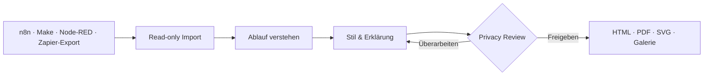

<div align="center">

**Deutsch** · [English](docs/README.en.md)

<picture>
  <source media="(prefers-color-scheme: dark)" srcset="assets/brand/showcase-hero-dark.svg" />
  
</picture>

# Showcase Studio

### Technische Workflows. Klar erzählt.

**Ein lokales Präsentationsstudio für n8n-Automationen: verstehen, gestalten, sicher prüfen und bewusst weitergeben.**

**Windows 10/11 · Community Preview · Öffentliche Version `v1.0.0-beta.6`**

[**Beta 6 herunterladen**](https://github.com/rootkid-code/showcase-studio-releases/releases/tag/v1.0.0-beta.6) · [**Erste Schritte**](docs/GETTING_STARTED.md) · [**Funktionen**](#funktionen-der-beta) · [**Dokumentation**](docs/README.md)

</div>

> [!IMPORTANT]
> **Eine öffentliche Beta ist verfügbar – noch keine stabile Version.** Am 23. November 2026 wurde [`v1.0.0-beta.6`](https://github.com/rootkid-code/showcase-studio-releases/releases/tag/v1.0.0-beta.6) als **Pre-release mit Windows-ZIP** veröffentlicht. Das ist ein realer Download, aber **kein unabhängiger Nachweis** einer vollständig abgenommenen Windows-Installation, eines Security Audits oder einer produktionsreifen Stable-Version. Bitte zunächst nur mit synthetischen oder ausdrücklich freigegebenen Workflows testen und Daten sichern. **Code → Download ZIP** ist nur das Dokumentationsrepository, nicht die App.

## Die Idee

Ein technisch funktionierender Workflow ist nicht automatisch eine überzeugende Erklärung. Zwischen Triggern, Bedingungen, Sub-Workflows und Sticky Notes verschwindet oft die eigentliche Prozessgeschichte.

**Showcase Studio macht komplexe Automationen zu verständlichen Präsentationen, ohne die Originalworkflows auszuführen oder zu verändern.**

<table>
<tr>
<td width="33%" valign="top"><h3>01 / Verstehen</h3><p>Nodes, Abzweigungen, Notizen und zusammenhängende Prozesse lesen.</p></td>
<td width="33%" valign="top"><h3>02 / Gestalten</h3><p>Passende Styles wählen, Abläufe fokussieren, eigene Story erklären.</p></td>
<td width="34%" valign="top"><h3>03 / Freigeben</h3><p>Texte und Daten kontrollieren, bewusst prüfen und offline exportieren.</p></td>
</tr>
</table>



*Showcase Studio ist kein Workflow-Editor, keine Automations-Ausführungsplattform und keine automatische Datenschutz-Zertifizierung.*

## Funktionen der Beta

Die folgende Übersicht basiert auf den **öffentlichen Release Notes von Beta 4 bis Beta 6**. Sie beschreibt enthaltene Funktionen, nicht von uns unabhängig durchgeführte Tests.

| Bereich | Was die Release Notes beschreiben |
|:--|:--|
| **Import** | n8n-JSON-Dateien und optionale Verbindung mit n8n; lokale Workflow-Bibliothek. Seit Beta 5 Datei-Import von Make-Blueprints, Zapier-Exporten und Node-RED-Flows; seit Beta 6 lesende Live-Verbindung zu Make und Node-RED, Zapier geführt über den offiziellen Datenexport |
| **Canvas & Präsentation** | Interaktive Graphen, Node-Fokus, Sticky Notes, Abschnitte und Layout-Anpassungen |
| **8 Designstile** | n8n, Make, Zapier, Node-RED (seit Beta 6), Blueprint, Neon Aurora, Skizzenbuch und Linienplan |
| **Zusammenhänge** | Workflow-Landkarte, Sub-Workflow-Navigation, Versionenvergleich und optionaler Sync; seit Beta 6 lesende Änderungsprüfung vor dem Synchronisieren |
| **Sicherheitsprüfung** | Privacy-Check für freizugebende Inhalte mit manuellen Korrektur- und Freigabeschritten |
| **Ausgabe** | Offline-HTML, Galerie, SVG/PNG, PDF-Handout, Markdown/Mermaid und weitere dokumentierte Formate |
| **Vorlagen & UX** | Handout, Portfolio, Community und technische Doku; geführte Einrichtung, Dark/Light, kompakte Menüs |

**Wichtig:** Make-, Zapier- und Node-RED-Importe sind **laut Release Notes von Beta 5 und 6** enthalten, aber **nicht unabhängig geprüft**. Für Zapier läuft der Import laut Release Notes über den offiziellen Datenexport, da Zapier keine Lese-Schnittstelle für Zaps anbietet. Die Herkunft eines Workflows und sein gewählter Stil bleiben unterschiedliche Dinge. [Feature-Status](docs/FEATURE_STATUS.md) (noch auf Stand Beta 4).

## Acht Looks. Ein Workflow.

| Anbieterorientiert | Präsentation & kreativ |
|:--|:--|
| **n8n** – vertrauter Node-Flow | **Blueprint** – technische Zeichnung |
| **Make** – runde, modulare Darstellung | **Neon Aurora** – atmosphärischer Tech-Look |
| **Zapier** – klare Step-Ansicht | **Skizzenbuch** – handgezeichnete Erklärung |
| **Node-RED** – farbige Knoten nach Node-Typ | **Linienplan** – Prozesse wie Stationen |

Alle acht sind **eigenständige visuelle Interpretationen** und keine offiziell bereitgestellten Anbieter-Oberflächen. Die drei kreativen Looks ergänzen den technischen Blueprint-Stil. [Brand Guide](docs/BRANDING.md).

## Beta 6 ausprobieren

1. [**Release v1.0.0-beta.6**](https://github.com/rootkid-code/showcase-studio-releases/releases/tag/v1.0.0-beta.6) öffnen und unter **Assets** die Datei **`ShowcaseStudio-1.0.0-beta.6.zip`** herunterladen. Nicht den automatischen Source-Code-Download.
2. Optional mit PowerShell prüfen:

   ```powershell
   Get-FileHash .\ShowcaseStudio-1.0.0-beta.6.zip -Algorithm SHA256
   ```

   Erwartete Prüfsumme laut Release Notes:  
   `c03b916f0786ea67a3dc016f58cbc0c7c50a24d98a3778c953b1f0d4fbe2d285`

   Das Release enthält außerdem `release.json` (Manifest mit Prüfsumme) und `release.json.sig` (Ed25519-Signatur), mit denen das Studio laut Release Notes Updates prüft.

3. ZIP **vollständig entpacken** und nach Release-Anleitung **`01-INSTALLIEREN.vbs`** starten.
4. Zunächst einen **synthetischen Workflow als JSON-Datei** importieren. Dafür ist keine Live-Verbindung zu n8n erforderlich.

**Voraussetzungen laut Release Notes:** Windows 10 oder 11, 64 Bit; Python 3.11+. Die native Installation wurde für diese Dokumentationsaktualisierung **nicht selbst getestet**.

[Ausführliche Anleitung](docs/GETTING_STARTED.md) · [Probleme & Support](SUPPORT.md) · [Alle Releases](https://github.com/rootkid-code/showcase-studio-releases/releases)

## Sicherheit, Roadmap und Transparenz

Workflow-Namen, interne Links, Notizen und sogar die bloße Prozessstruktur können vertrauliche Informationen verraten. Deshalb: **lokal importieren → prüfen → bereinigen → freigeben → die erzeugte Datei nochmals öffnen**. Automatische Kontrollen ersetzen nicht die Verantwortung für das Teilen.

**Heute:** Community-Beta, Benutzerfeedback, reproduzierbare Windows-/Upgrade-Nachweise, Datenschutz und ruhige UX.  
**Laut Release Notes enthalten (Beta 5/6):** Importe aus **Make**, **Zapier** und **Node-RED**; unabhängige Prüfung steht aus.  
**Geplant:** Weitere Formate.  
**Zurückgestellt:** Öffentliche Preisgestaltung, Checkout und Pro-Vermarktung.

Die Darstellung einer Plattform ist **kein Beleg**, dass deren Dateiformat schon unterstützt wird. [Entwicklungsrichtung](docs/PROJECT_DIRECTION.md).

## Dokumentation

| Für Anwender | Für Entwickler & Review |
|:--|:--|
| [Erste Schritte](docs/GETTING_STARTED.md) | [Feature-Status](docs/FEATURE_STATUS.md) |
| [Studio-Handbuch](docs/USAGE_GUIDE.md) | [Release-Qualitätsstandard](docs/RELEASE_POLICY.md) |
| [Datenschutz & Export](docs/PRIVACY_AND_EXPORT.md) | [Marke & Medien](docs/BRANDING.md) |
| [Fehlerbehebung](docs/TROUBLESHOOTING.md) | [Rechte & Hinweise](NOTICE.md) |
| [Support / Feedback](SUPPORT.md) | [Sicherheitsmeldungen](SECURITY.md) |

<details>
<summary><strong>Kurze Antworten auf häufige Fragen</strong></summary>

**Gibt es einen Download?** Ja, als **öffentliche Beta**; keine offiziell stabile Freigabe.

**Kann ich Make-, Zapier- oder Node-RED-Workflows importieren?** Laut Release Notes ja: seit Beta 5 per Datei, seit Beta 6 für Make und Node-RED auch per lesender Live-Verbindung; Zapier über den offiziellen Datenexport. Unabhängig geprüft ist das nicht.

**Verändert Showcase Studio n8n-Workflows?** Nein – das Produkt ist als **lesendes Präsentationswerkzeug** konzipiert. Die effektiven Rechte werden in n8n begrenzt.

**Ist der Source Code Open Source?** Nein. Der Anwendungscode bleibt privat; der öffentliche Hub enthält Dokumentation, Markenmaterial und Beta-Artefakte. [Rechtliches](NOTICE.md).

</details>

---

<div align="center">


**Showcase Studio** · *Understand the workflow. Tell the story.*

[Releases](https://github.com/rootkid-code/showcase-studio-releases/releases) · [English](docs/README.en.md) · [rootkid / code](https://github.com/rootkid-code)

<sub>© 2026 Florian Windhager · Unabhängiges Projekt · Keine Partnerschaft mit n8n, Make, Zapier oder Node-RED</sub>
</div>
