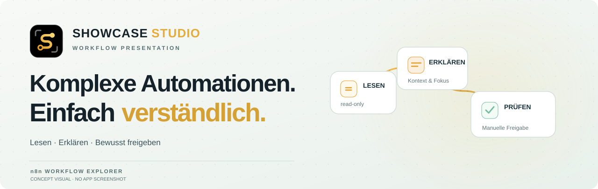
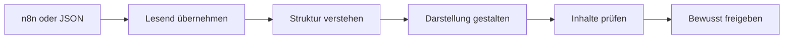

**Deutsch** · [English](docs/README.en.md)

<picture>
  <source media="(prefers-color-scheme: dark)" srcset="assets/brand/showcase-hero-dark.svg" />
  
</picture>

# Showcase Studio

**Workflow-Komplexität reduzieren. Prozesse überzeugend erklären.**

Ein lokaler Präsentations- und Dokumentations-Workspace für n8n-Automationen.

[**Produkt**](#was-ist-showcase-studio) · [**Funktionen**](#produktbereiche) · [**Erste Schritte**](docs/GETTING_STARTED.md) · [**Dokumentation**](docs/README.md) · [**Releases**](https://github.com/rootkid-code/showcase-studio-releases/releases)

> [!IMPORTANT]
> **Öffentliche Community-Beta verfügbar – keine Stable-Freigabe.** [v1.0.0-beta.3](https://github.com/rootkid-code/showcase-studio-releases/releases/tag/v1.0.0-beta.3) wurde am **23. November 2026** mit Windows-ZIP, Manifest und Signaturdatei veröffentlicht. Native Windows-/Browser-Abnahme sowie unabhängige Sicherheits- und Signaturprüfungen sind hier **nicht als bestanden dokumentiert**. Bitte zuerst mit synthetischen Workflows testen und vor Upgrades die Bibliothek sichern. **Code → Download ZIP** ist nur die Dokumentation, nicht das Programm.

## Was ist Showcase Studio?

Ein funktionierender n8n-Workflow ist nicht automatisch eine verständliche Präsentation. Knoten, Verzweigungen, technische Bezeichnungen und Sticky Notes verdecken häufig die eigentliche Prozessgeschichte.

**Showcase Studio** untersucht einen anderen Blickwinkel: Workflows lesend übernehmen, Zusammenhänge klar darstellen und eine Präsentationsfassung **erst nach bewusster Prüfung** weitergeben.

<table>
<tr>
<td width="33%" valign="top">
  <strong>01 / Verstehen</strong>  
  Die Struktur eines Workflows erkunden, Verbindungen nachvollziehen und wichtige Schritte herausarbeiten.
</td>
<td width="33%" valign="top">
  <strong>02 / Präsentieren</strong>  
  Aus technischen Abläufen eine lesbare Geschichte mit Canvas, Abschnitten und Node-Fokus machen.
</td>
<td width="34%" valign="top">
  <strong>03 / Freigeben</strong>  
  Texte, Notizen und Daten vor jeder Weitergabe kontrollieren – der Originalworkflow bleibt getrennt.
</td>
</tr>
</table>

**Für wen?** Für Menschen, die Automationen entwickeln, erklären oder gemeinsam mit Teams überprüfen: Freelancer, Agenturen, interne Prozessverantwortliche, Entwickler und Lernende.

## Ein klarer Ablauf

Der Workflow läuft weiterhin in **n8n**. Showcase Studio ist **kein n8n-Editor und kein Ersatz für die Ausführung**. Bei einer Live-Verbindung müssen Zugriffsrechte direkt in n8n auf das notwendige Minimum begrenzt werden.

## Produktbereiche

Die Module sind im privaten Entwicklungsprojekt vorhanden, werden dort weiterentwickelt oder sind als nächste Schritte dokumentiert. **Das öffentliche Prerelease beschreibt mehrere dieser Funktionen. Das Vorhandensein des ZIPs beweist jedoch weder deren vollständige Funktionsprüfung noch die Kompatibilität mit allen Geräten.**

| Bereich | Was daraus entsteht | Entwicklungsstand |
|:--|:--|:--|
| n8n / JSON | Workflow-Import und geführte Verbindung | In Beta.3 beschrieben; eigenständige E2E-Abnahme offen |
| Präsentationsstudio | Canvas, Abschnitte, Node-Fokus und Sticky Notes | In Beta.3 beschrieben; eigenständige E2E-Abnahme offen |
| Workflow-Landkarte | Aufrufketten und Sub-Workflow-Beziehungen | In Beta.3 beschrieben; neuere private Zweige getrennt |
| Versionen & Vergleich | Strukturelle Unterschiede nachvollziehbar erklären | In Beta.3 beschrieben; neuere private Zweige getrennt |
| Exporte | HTML, SVG, PNG, Markdown, Mermaid und weitere Formate | Beta.3-Release-Notes beschreiben Exporte; E2E-QA nicht belegt |
| Privacy Review | Bereinigen, prüfen und bewusst freigeben | Beta.3 beschreibt Privacy Review; keine Zertifizierung |

Mehr Details: [Feature-Status und Prüfgrenzen](docs/FEATURE_STATUS.md).

## Visuelle Identität

**Gold · Graphite · ruhige, funktionale Oberflächen**

Die Marke verwendet die tatsächlich vorhandenen Original-Assets des Projekts. Die Titellayouts oben sind eigene Konzeptgrafiken – keine Screenshots eines ausführbaren Builds.

Die bisherigen Screenshots gehören zu einer älteren Oberfläche und sind deshalb aus dieser Präsentation entfernt. Du findest sie weiterhin im eindeutig beschrifteten [historischen Bildarchiv](docs/VISUAL_ARCHIVE.md). Neue Produktbilder werden erst mit tatsächlichem Build-Nachweis, Testdaten und visueller Freigabe gezeigt.

## Beta herunterladen und sicher ausprobieren

1. [**v1.0.0-beta.3 mit ZIP und Release Notes öffnen**](https://github.com/rootkid-code/showcase-studio-releases/releases/tag/v1.0.0-beta.3).
2. Unter **Assets** die Datei **ShowcaseStudio-1.0.0-beta.3.zip** laden – nicht die automatisch erzeugte GitHub-Source-ZIP.
3. Die [veröffentlichte SHA-256-Prüfsumme](docs/releases/v1.0.0-beta.3.md) mit PowerShell prüfen, vollständig entpacken und laut Release Notes **01-INSTALLIEREN.vbs** starten.
4. Zuerst einen synthetischen lokalen JSON-Workflow testen. Für den JSON-Import ist keine n8n-Verbindung notwendig.
5. Vor jedem Export vertrauliche Inhalte, Prozessstrukturen, URLs und Notizen selbst kontrollieren.

**Die Beta ist ein öffentliches Testpaket, kein nachgewiesener Stable-Build.** [Installationsanleitung](docs/GETTING_STARTED.md) · [Release-Nachweise und Grenzen](docs/releases/v1.0.0-beta.3.md).

## Dokumentation

<table>
<tr>
<td width="50%" valign="top">

**Für Anwender**

- [Erste Schritte](docs/GETTING_STARTED.md)
- [Studio & Workflow-Präsentation](docs/USAGE_GUIDE.md)
- [Datenschutz & Export](docs/PRIVACY_AND_EXPORT.md)
- [Fehlerbehebung](docs/TROUBLESHOOTING.md)

</td>
<td width="50%" valign="top">

**Produkt & Freigabe**

- [Features und Reifegrad](docs/FEATURE_STATUS.md)
- [Projektfokus und Prioritäten](docs/PROJECT_DIRECTION.md)
- [Marke & Medien](docs/BRANDING.md)
- [Release-Kriterien](docs/RELEASE_POLICY.md) · [Beta.3-Artefakte](docs/releases/v1.0.0-beta.3.md)

</td>
</tr>
</table>

[Gesamte Dokumentation](docs/README.md) · [Support](SUPPORT.md) · [Sicherheitsmeldungen](SECURITY.md) · [Rechte & Hinweise](NOTICE.md)

## Wohin entwickelt sich Showcase Studio?

Der aktuelle Fokus ist **eine zuverlässige, verständliche Free-/Community-Beta** – mit nachvollziehbaren Tests, sicherer Installation, hilfreicher Dokumentation und echten Rückmeldungen.

**Verkauf, Preise und Pro-Editionen sind derzeit ausdrücklich zurückgestellt.** Frühere Ideen und experimentelle Pro-Module sind keine Ankündigung eines Kaufprodukts. [Projektentscheidung lesen](docs/PROJECT_DIRECTION.md).

## Häufige Fragen

<strong>Wo ist der Download?</strong>

Das öffentliche **Prerelease v1.0.0-beta.3** enthält unter <a href="https://github.com/rootkid-code/showcase-studio-releases/releases/tag/v1.0.0-beta.3">GitHub Releases</a> das eigentliche Windows-ZIP. Der <strong>Code → Download ZIP</strong>-Button liefert nur die Dokumentation.

<strong>Ändert Showcase Studio meine Workflows?</strong>

Das Produkt ist als <strong>lesender Explorer</strong> ausgelegt. Ein API-Key soll dafür nur die nötigen Leserechte erhalten; die tatsächliche Zugriffsbeschränkung muss in n8n erfolgen. Vor einer externen Präsentation ist eine eigene Inhaltsprüfung erforderlich.

<strong>Ist dieses Repository Open Source?</strong>

Nein. Das öffentliche Repository enthält eine Produktvorstellung, Dokumentation und zukünftig gegebenenfalls geprüfte Installationsdateien – nicht den privaten Anwendungscode. Siehe <a href="NOTICE.md">Rechte & Hinweise</a>.

---

  

  **Showcase Studio**

  Understand the workflow. Tell the story. Review before sharing.

  © 2026 · rootkid-code · Independently developed · Not affiliated with n8n

