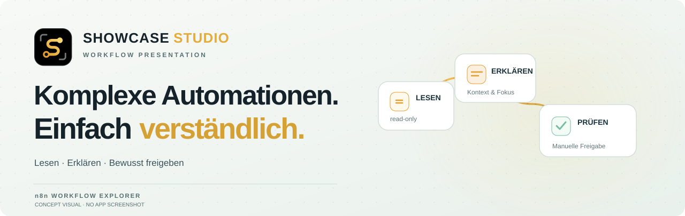
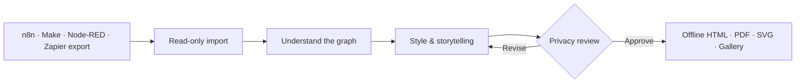

<div align="center">

[Deutsch](../README.md) · **English**

<picture>
  <source media="(prefers-color-scheme: dark)" srcset="../assets/brand/showcase-hero-dark.svg" />
  
</picture>

# Showcase Studio

### Complex workflows. Clearly explained.

**A local-first, read-only presentation workspace for n8n automations — explore, present, review and share.**

**Windows 10/11 · Community Preview · Public version `v1.0.0-beta.6`**

[**Download Beta 6**](https://github.com/rootkid-code/showcase-studio-releases/releases/tag/v1.0.0-beta.6) · [**Getting started**](GETTING_STARTED.md) · [**Capabilities**](#beta-capabilities) · [**Documentation**](README.md)

</div>

> [!IMPORTANT]
> **The public beta is available, but this is not a stable release.** On November 23, 2026, [`v1.0.0-beta.6`](https://github.com/rootkid-code/showcase-studio-releases/releases/tag/v1.0.0-beta.6) was published as a **pre-release with a Windows ZIP**. This does not imply independent Windows end-to-end validation or security certification. Start with synthetic test workflows and keep backups. **Code → Download ZIP** only downloads this documentation repository, **not the app**.

## Why Showcase Studio?

A working automation is not necessarily an understandable explanation. Branches, technical steps, notes and cross-workflow references can obscure the business story.

**Showcase Studio makes a workflow easier to explain without executing or editing the original automation.**

| Explore | Present | Review |
|:--|:--|:--|
| Trace nodes, branches, notes and related flows. | Choose the right look, focus on key steps and tell a coherent story. | Check sensitive information, explicitly approve content and inspect actual exported files. |



*Showcase Studio is not an automation execution service, workflow editor or compliance certification.*

## Beta capabilities

These features are described in the **published release notes for Beta 4 through Beta 6**, not independently verified in this documentation update.

| Area | What the release notes describe |
|:--|:--|
| **Import** | n8n JSON files, optional n8n connection and local library. Since Beta 5: file import of Make blueprints, Zapier exports and Node-RED flows. Since Beta 6: read-only live connection to Make and Node-RED; Zapier guided through its official data export |
| **Canvas** | Interactive diagrams, node focus, notes, sections and presentation editing |
| **8 visual looks** | n8n, Make, Zapier, Node-RED (since Beta 6), Blueprint, Neon Aurora, Sketchbook and Metro Map |
| **Context** | Workflow map, sub-workflow navigation, version comparison and optional sync; since Beta 6 a read-only change check before syncing |
| **Privacy** | Sensitive-content review, corrections and manual approval before sharing |
| **Export** | Offline HTML, galleries, SVG/PNG, PDF, Markdown/Mermaid and more |
| **Presets & UX** | Handout, portfolio, community, technical docs; guided setup and accessible controls |

**Make, Zapier and Node-RED imports are described in the Beta 5 and Beta 6 release notes but not independently verified.** Per the release notes, Zapier import goes through Zapier's official data export, since Zapier offers no read API for Zaps. [Feature status](FEATURE_STATUS.md) (still reflects Beta 4).

## Eight styles, one original workflow

**Provider-inspired:** n8n · Make · Zapier · Node-RED. **Technical:** Blueprint. **Creative:** Neon Aurora · Sketchbook · Metro Map.

These are independent visual interpretations, not official vendor UIs or partnerships. The original **workflow source** remains distinct from the selected presentation look.

## Download and try Beta 6

1. Visit the [`v1.0.0-beta.6` release](https://github.com/rootkid-code/showcase-studio-releases/releases/tag/v1.0.0-beta.6) and download **`ShowcaseStudio-1.0.0-beta.6.zip`** from **Assets**, not the generated source ZIP.
2. Optionally verify the checksum in PowerShell:

   ```powershell
   Get-FileHash .\ShowcaseStudio-1.0.0-beta.6.zip -Algorithm SHA256
   ```

   Expected SHA-256 per the release notes:  
   `c03b916f0786ea67a3dc016f58cbc0c7c50a24d98a3778c953b1f0d4fbe2d285`

   The release also ships `release.json` (manifest with checksum) and `release.json.sig` (Ed25519 signature), which the studio uses to verify updates according to the release notes.
3. Fully extract the ZIP, then run **`01-INSTALLIEREN.vbs`** following the included release instructions.
4. Begin with a **synthetic n8n JSON test workflow**; file import does not require a live connection.

**Prerequisites in the release notes:** 64-bit Windows 10 or 11 and Python 3.11+. This documentation change did not run native Windows installation tests.

[Getting started](GETTING_STARTED.md) · [Support](../SUPPORT.md) · [Releases](https://github.com/rootkid-code/showcase-studio-releases/releases)

## Privacy, roadmap and support

Internal URLs, notes, names and business process structure can be confidential even without credentials. **Review → sanitize → explicitly approve → inspect the actual export.** Don't post API keys, customer workflows or unsanitized logs in public issues.

**Now:** public beta feedback, Windows installation/upgrade QA, privacy and clear UX. **Described in the Beta 5/6 release notes:** Make, Zapier and Node-RED imports, pending independent verification. **Planned:** further formats. **On hold:** Pro commercialization, pricing and checkout. Planned work is not a shipped feature.

[Privacy & export](PRIVACY_AND_EXPORT.md) · [Release policy](RELEASE_POLICY.md) · [Product direction](PROJECT_DIRECTION.md) · [Legal](../NOTICE.md) · [Security](../SECURITY.md)

---

<div align="center">


**Showcase Studio** · *Understand the workflow. Tell the story.*

<sub>© 2026 Florian Windhager · Independent project · Not affiliated with n8n, Make, Zapier or Node-RED</sub>
</div>
