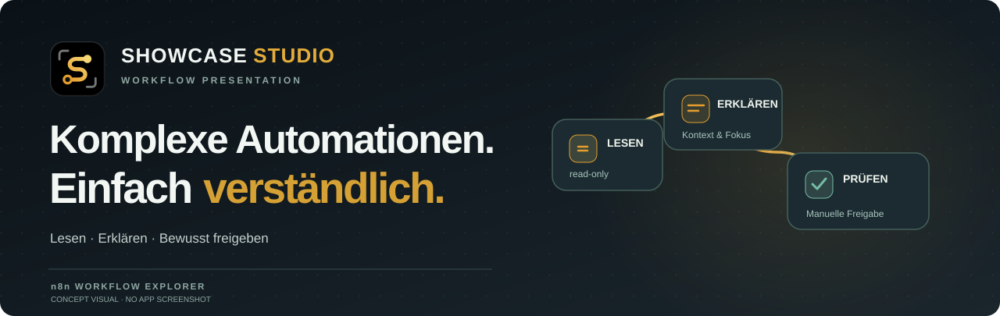

[Deutsch](../README.md) · **English**

# Showcase Studio

**Make complex n8n workflows understandable.**

A local, read-only workspace for explaining, reviewing, and preparing workflow presentations.

[Product](#what-is-showcase-studio) · [Capabilities](#development-capabilities) · [Getting started](GETTING_STARTED.md) · [Releases](https://github.com/rootkid-code/showcase-studio-releases/releases)

> [!IMPORTANT]
> **No public application download yet.** As of **November 23, 2026**, this public distribution repository contains documentation and branding, but **no released Windows installer**. Private development milestones are not product releases. GitHub's automatic source ZIP is **not** the application.

## What is Showcase Studio?

An automation can work perfectly in n8n and still be hard to explain. Showcase Studio explores a **presentation-first** approach: read the workflow structure, clarify the business process, and consciously approve what may be shared.

**The workflow stays in n8n.** Showcase Studio is designed for read-only inspection, not execution or editing.

| Explore | Explain | Review |
|:--|:--|:--|
| Read graph connections, sections and node descriptions. | Build a more understandable presentation of technical processes. | Check notes, labels, URLs and information before external sharing. |

It is intended for automation builders, consultants, agencies, educators and internal operations teams.

## Development capabilities

The following areas exist in private project branches or documented designs; **none are currently promised as a publicly supported build**.

- n8n/JSON import, presentation canvas, notes and node focus
- Workflow maps, linked sub-workflows and structural comparisons in advanced development branches
- Export mechanisms including HTML, SVG, PNG, Markdown and Mermaid
- Privacy reviews and explicit release approval concepts
- Windows-first packaging that still requires real native end-to-end sign-off

See [feature maturity](FEATURE_STATUS.md), [privacy and exports](PRIVACY_AND_EXPORT.md) and [release quality standards](RELEASE_POLICY.md).

## How to start after an actual release

Open [GitHub Releases](https://github.com/rootkid-code/showcase-studio-releases/releases), choose a concrete version with an attached installation artifact, read its requirements and checksums, and follow the included installation guide. Start with synthetic demo workflows; only later consider an n8n read-only connection.

**There is no downloadable application in this repository yet.**

## Brand and screenshots

The gold S-workflow logo is the current original brand. The header is conceptual artwork, **not a captured application UI**. Older screenshots are available only in a labeled [historical gallery](VISUAL_ARCHIVE.md). Current screenshots will be shared only after capturing a verified build.

[Brand guide](BRANDING.md) · [Documentation index](README.md) · [Support](../SUPPORT.md)

## Current focus

**The immediate priority is a reliable Free/Community Beta**, real platform testing, privacy review, an understandable installer and useful documentation. **Paid offerings, pricing and Pro plans are explicitly on hold.** See [project direction](PROJECT_DIRECTION.md).

This public repository is **not an open-source grant** for the private application. See [legal notices](../NOTICE.md).

---

© 2026 rootkid-code · Showcase Studio · Not affiliated with n8n

