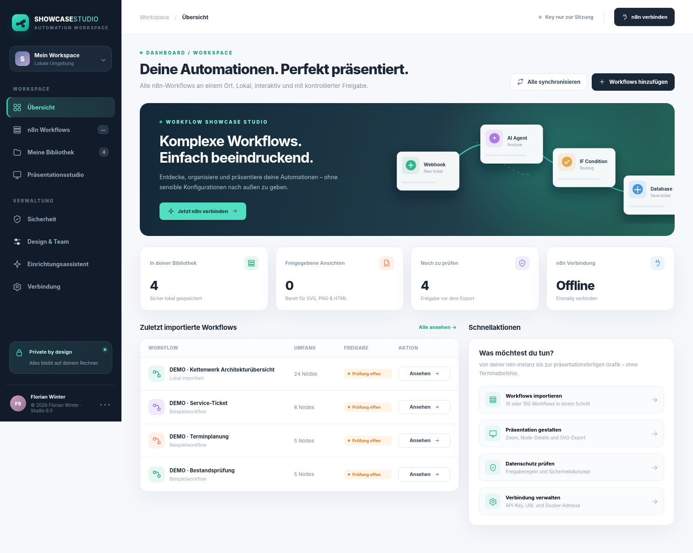
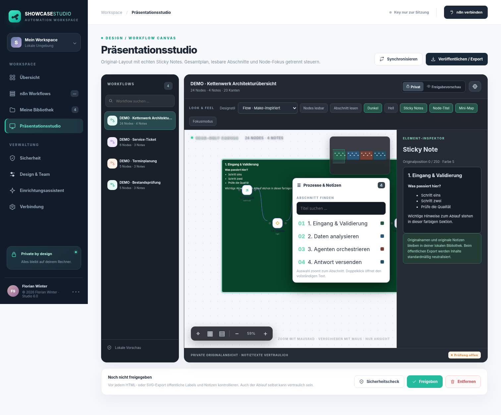
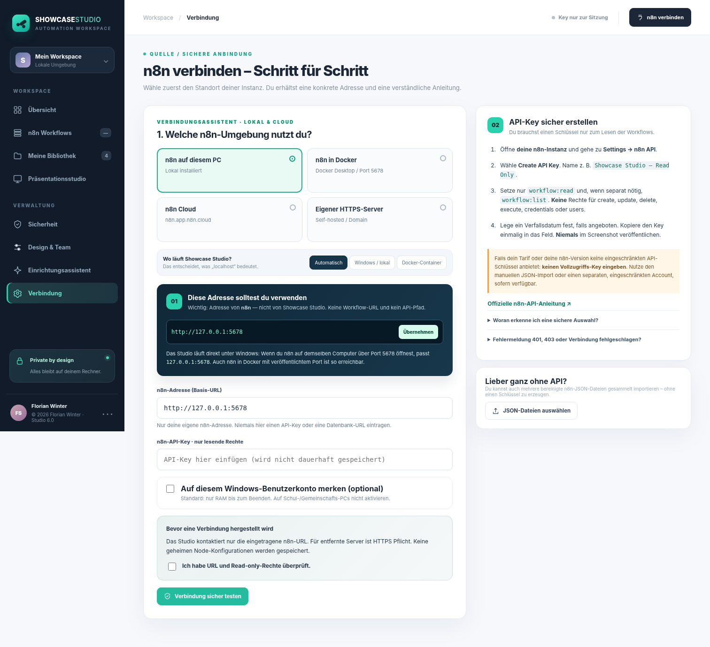

# Produktbild-Archiv · Historische Entwicklungsansichten

> **Nicht aktuell.** Diese Screenshots stammen aus einem früheren Entwicklungsstand, der noch ein türkises beziehungsweise andersfarbiges Interface zeigt. Build/Datum der einzelnen Aufnahmen sind hier nicht verifiziert. Sie dürfen **nicht** als aktuelle 14.1- oder öffentliche Beta-Oberfläche beworben werden.

## Dashboard / Workspace

*Ältere UI-Vorschau. Nicht identisch mit der aktuellen goldenen Markenidentität.*

## Canvas / Abschnitte

*Demo-Workflow mit Abschnittsübersicht; keine Live-Produktfreigabe.*

## Verbindung

*Der Screenshot enthält beispielhafte Verbindungsangaben. Der tatsächliche aktuelle Assistent kann abweichen.*

## Voraussetzungen für eine neue Galerie

1. Screenshot aus einem gestarteten Build mit **versioniertem Git-Commit** und Testumgebung aufnehmen.
2. Nur synthetische Workflows; sämtliche Credentials, IDs, Namen, URLs und internen Details vorab und nachher prüfen.
3. Neues goldenes S-Logo sowie korrekte Dark-/Light- und Theme-Zustände kontrollieren.
4. Dashboard, Canvas, Import, Privacy-Check und Export mit sauberer Nachweisdatei abbilden.
5. Erst danach diese historische Galerie durch aktuelle Bilder in der Haupt-README ersetzen.

[Markenhandbuch](BRANDING.md) · [Zurück zur README](../README.md)
